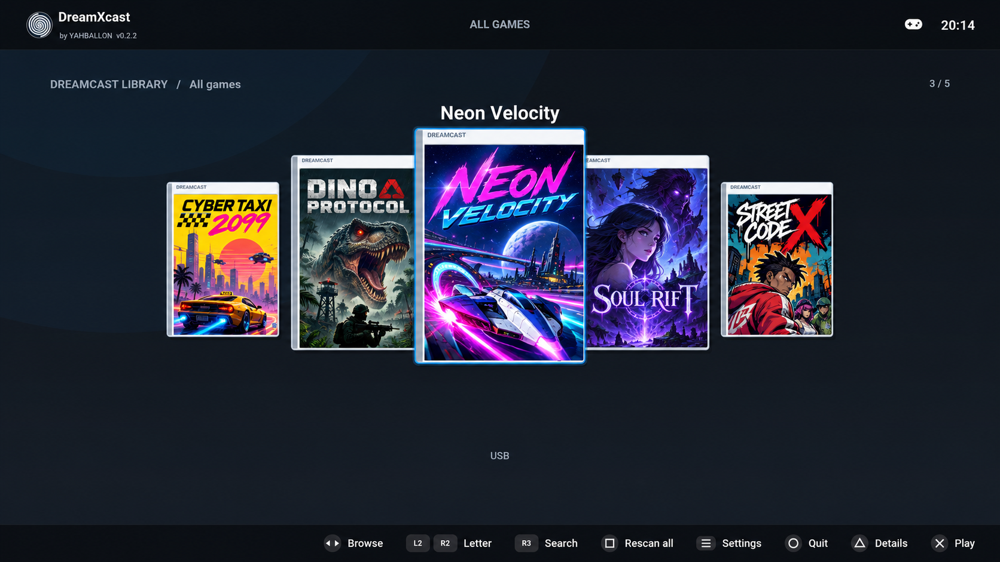

# DreamXcast
<p align="center">
  
</p>
**Native Dreamcast emulation on PS5 with white DVD-style CoverFlow cases, angled neighbours and subtle reflections.**

Version **0.2.2** · Title ID **PPSA99765** · **by YAHBALLON**.

The application integrates the *native* PS5 Flycast platform port from
[PSFlycast](https://github.com/Press5elect/PSFlycast), pinned at
`1cc6b2978d891f93cd2e36123ba4fd14118bd444`. The custom shelf uses
its working RADV/Vulkan game output, SH-4/AICA emulator, DualSense mapping,
VMU and GD-ROM media handling. This UI recreates the **visual style** of the
[PS5GBAX](https://github.com/Yahballon/PS5GBAX) / PS5SX2 3D cover-flow shelf;
it is not a byte-for-byte copy of the GBAX Vulkan renderer. The GBA core is
not used.

## Build

DreamXcast is now maintained at **[Yahballon/DreamXcast](https://github.com/Yahballon/DreamXcast)**. Its workflow is
`.github/workflows/build-ps5-dreamcastx.yml` and runs after app-specific
changes on `main`, for pull requests, or on manual dispatch. On Ubuntu 24.04
it installs build prerequisites, fetches pinned Flycast source, adapts the
frontend and title metadata, bootstraps PS5_Vulkan/RADV and SDK dependencies,
then compiles and verifies the real signed PS5 application.

On successful **main pushes** and manual runs on main, the workflow compiles the native PS5 SELF,
verifies the installable `PPSA99765.zip`, uploads it as a build artifact, then creates the versioned
[GitHub Release](https://github.com/Yahballon/DreamXcast/releases) in the **same successful job**.
PR builds only produce temporary test artifacts. Failed builds cannot publish releases.
No ROM, BIOS or firmware is supplied. A source-only ZIP is **not** installable.

Run locally from the repository root (requires clang 18, CMake/Ninja, PS5 stack):

```bash
python3 scripts/prepare.py
bash scripts/bootstrap-ps5.sh
bash scripts/build.sh
```

Build output: `dist/PPSA99765.zip`. A heavy RADV dependency build may exceed
GitHub-hosted time/resources; inspect Actions logs if it does. Compilation is
not a substitute for testing games on a real PS5.

## App installation vs persistent data

The testbuild ZIP stays named `PPSA99765.zip` (title ID in PS5 metadata).
It contains one install directory, `PS5DreamcastX/`:

```text
/data/homebrew/PS5DreamcastX/eboot.bin       # PS5 executable
/data/homebrew/PS5DreamcastX/sce_sys/        # PS5 metadata/icon
```

**All emulator data is separate**, under `/data/PS5DreamcastX/`:

```text
/data/PS5DreamcastX/games/                  # internal games (CHD, GDI, CDI, CUE)
/data/PS5DreamcastX/bios/                   # optional BIOS
/data/PS5DreamcastX/covers/                 # downloaded and custom cover art
/data/PS5DreamcastX/data/                   # saves, VMUs, library/history
/data/PS5DreamcastX/data/savestates/        # save states
/data/PS5DreamcastX/vmu/                    # VMU export/import
/data/PS5DreamcastX/cheats/
/data/PS5DreamcastX/logs/
/data/PS5DreamcastX/frontend.cfg            # UI/USB settings
/data/PS5DreamcastX/emu.cfg                 # emulator settings
/data/PS5DreamcastX/network.cfg             # SMB library
```

The directories are created automatically at startup when filesystem
elevation succeeds. PS5DreamcastX tries `elfldr` at port **9021** before
selecting the data location, even when USB browsing is switched off.
If external /data cannot be opened, the app continues using its mounted
app directory as a fallback; check the boot log for `storage: app=... data=...`.
The empty-library screen shows the actual path used by the process.

**Migration from v0.1.1:** Before running this new build, back up the
existing `games/`, `bios/`, `covers/`, `data/` (saves),
`frontend.cfg`, `emu.cfg` and `network.cfg` from the old app
directory `/data/homebrew/PS5DreamcastX/` and copy/move them under
`/data/PS5DreamcastX/`. The app does **not** delete or automatically
move them. Leave `eboot.bin`, `sce_sys/`, `sce_module/` and
`BUILD.txt` under the installation directory.

### USB games

Plug a USB drive into the PS5. The application discovers
`PS5DreamcastX` case-insensitively on any of `/mnt/usb0/` through
`/mnt/usb7/` and **recursively scans the entire** `PS5DreamcastX/` directory, including
`games/` and any other nested folders. Root games are never skipped. Existing
`flycast/`, `dreamcast/`, `dc/`, `naomi/`, `atomiswave/`, and
`arcade/` USB folders remain supported.

```text
/mnt/usb0/PS5DreamcastX/games/Game.chd
/mnt/usb0/PS5DreamcastX/games/Game.gdi
/mnt/usb1/PS5DreamcastX/AnotherGame.cdi  # if games/ absent
```

USB access **requires filesystem elevation** (a jailbreak with
`elfldr` listening on port **9021**) and the app's
**Settings > Library > USB drives** enabled, followed by an app restart.
New installations default to enabling USB; an existing `frontend.cfg`
with `usb = 0` retains that preference until manually enabled.
In the library use **L1/R1** to select the USB tab and **Square** to rescan.

### DualSense

| Control | Action |
| --- | --- |
| D-pad / left stick | Navigate covers |
| Cross | Start selected game |
| Up / Down | Change shelf |
| Triangle | Game details |
| Square | Rescan library |
| L1 / R1 | Change source |
| Options | Settings |
| Circle | Back / exit dialog |

In-game menu, saves, disc switching and controller mapping follow PSFlycast.
Refer to its [manual](https://github.com/Press5elect/PSFlycast/blob/main/shell/ps5/MANUAL.md).

## Testing and limitations

The DreamXcast integration source, original shelf, USB/SMB settings, background
cover code, icon generator and tests live in this repository. The pinned
upstream PSFlycast core plus Vulkan/RADV/SDK dependencies are downloaded
and compiled by the workflow, not committed as vendor binaries.

The repo ships source transformation checks and a host C++ compile test.
Actual native compilation and physical-console testing must be tracked
separately. The native shell remains the upstream PSFlycast 1.1.0 implementation
with only app branding, shelf view, paths, icon and safe update-feed filtering
changed. Initial integration is **experimental**.

## Credits and licensing

Flycast and PSFlycast are GPL-2.0-or-later and retain their original notices;
original PS5GBAX/frontend reference is GPL-3.0-or-later. The new shelf overlay
is GPL-3.0-or-later; resulting combined distributions must respect all original
copyright and license notices. No commercial game assets or proprietary BIOS
files are included.


### v0.1.8: PS5 hardware renderer hotfix

Replaces the broken custom perspective image quads introduced in v0.1.4
with the known-working v0.1.3 `rect` + `imageFill` drawing path.
White Dreamcast cases and a larger centered game remain; artwork fills
each case immediately below its small Dreamcast header. Neighbour cases
are smaller to evoke depth without unsupported texture transforms.
To prevent images being scattered or blank on PS5, **angled texture quads
and reflections are temporarily disabled**. Full real-hardware verification
is still needed; this is not a claim that perspective is supported.
Saves, games, USB and /data/PS5DreamcastX paths are unchanged.

### v0.1.8: Nonblocking background cover loading

The original Flycast `ImguiFileTexture::getId()` decoded PNG/JPG files
synchronously inside the display loop, up to ten files in one frame.
On PS5DreamcastX, cover/boxart files now decode **off the render thread** using
one dedicated worker. Finished thumbnails are scaled down to max 640 pixels on
that worker and stored in a bounded in-memory queue (12 ready textures).
Only the render thread uploads to GPU, limited to two images per frame; GPU
texture caching still uses the upstream ImGuiDriver. The selected game and its
two immediate neighbours are requested first. Non-cover image handling stays
unchanged, and we did not touch the stable case renderer from v0.1.5.
Local files should no longer stall menu navigation. Initial network cover
downloads may still take time depending on the source and connection.

### v0.1.8: USB library fix

USB folders are scanned recursively from the top-level `PS5DreamcastX` directory, rather than selecting `games/` exclusively. Mixed layouts with game files in both locations work and case-insensitive game extensions are recognized. The console log now distinguishes recursive scan roots from detected media/titles. TheGamesDB temporary 503 errors only affect online artwork fetching.

### v0.1.8 — Cover cache on internal SSD

The original downloaded artwork stays in `/data/PS5DreamcastX/covers/`. This update stores already-decoded 640px thumbnails in `/data/PS5DreamcastX/cache/covers/`; after a restart, those thumbnails load without repeatedly decoding PNG/JPEG files. The cache checks each original file's size and modification date and automatically refreshes after a cover changes. Downloaded covers take priority over TheGamesDB metadata lookups; repeated failed metadata requests now back off for 15 minutes instead of 10 seconds. Initial artwork downloads still require a working network source. Games, BIOS and saves remain unchanged.

### v0.1.9: Show every detected game immediately

The PS5 log already reported all five available games, but the default
Dreamcast shelf was **Recently played** (2/2), not **All games** (5/5).
The console now starts each source tab on the complete **All games** shelf
and keeps **Recently played** and **Favourites** available with up/down.
New games appear on the selected shelf during the incremental USB scan.
The disc-selection popup retains its existing preferred disc-set shelf.
This fixes library selection, **not** the unrelated temporary TheGamesDB
HTTP 503 metadata warning. No games, covers or save data are changed.

### v0.2.0: All games together, SMB in Settings

Internal, USB, and SMB games now share the same CoverFlow, Grid, List,
search, Favourites, Recently played and disc selection views. No source tabs
are shown. Square rescans all configured sources. The source is displayed
under each game title, but the existing game launch and SMB streaming code
still uses the original file path.

In **Settings > Library**, edit SMB share 1–6, username, password and domain
with the PS5 keyboard. Existing additional share paths remain in network.cfg.
Settings are saved automatically to `/data/PS5DreamcastX/network.cfg`
with mode 0600. Password is masked. Restart the app after editing SMB
settings so that new credentials are used safely (never swap active SMB
credentials while the background scanner or a game is running).

### v0.2.1: DreamXcast branding

The app is now displayed as **DreamXcast** in the native game menu, splash,
PS5 launcher, about/update screens and app icon. The main menu reads
**by YAHBALLON  v0.2.1** under DreamXcast; no duplicated version under the clock.

Internal identity remains `PPSA99765` and the install folder is still
`/data/homebrew/PS5DreamcastX/`. Games, VMU, BIOS, artwork and settings stay
in `/data/PS5DreamcastX/` and work without manual migration. The GitHub
release tag prefix stays `ps5-dreamcastx-` to preserve auto-update support.


### v0.2.2: neon PS5 menu icon and independent GitHub releases

The PS5 launcher image is generated from `assets/dreamxcast-neon.avif` and
installed as `PS5DreamcastX/sce_sys/icon0.png`. No games or BIOS are supplied.
New builds and releases are now produced directly in this repository.

**For a future release:** update `app.json` (`version`, `releaseTag`,
`contentVersion`), commit to `main`, and allow the native build to finish.
The workflow publishes a versioned Release only after verifying the signed
`eboot.bin` and its installable ZIP. Existing releases are not overwritten.
